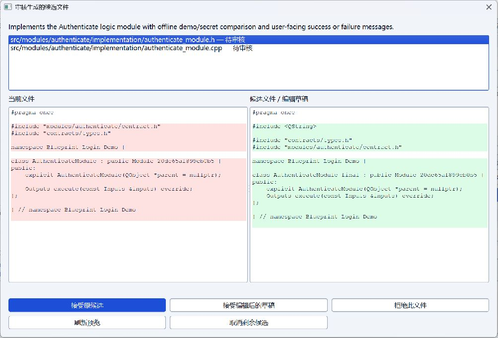
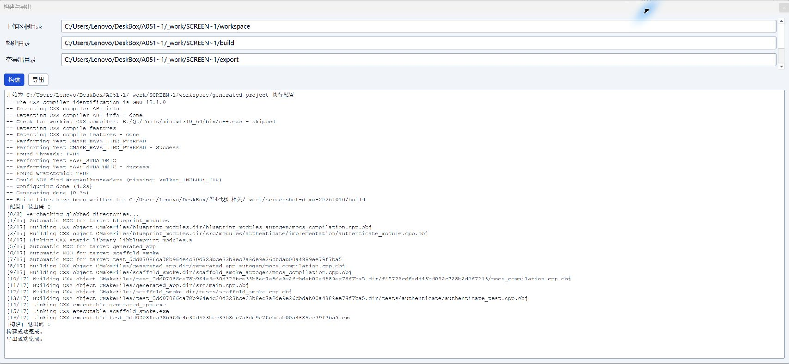

# Qt Blueprint Generator

基于 Qt 桌面的可视化、AI 辅助软件开发平台。通过蓝图描述模块、接口和连接关系，将设计转化为可审查、可构建、可导出的 Qt 应用工程。

项目以蓝图为主数据源，由确定性生成器维护公共契约和工程骨架，AI 实现模块内部代码。工作区面向生成与人工评审，不以开发完整 IDE 为目标。

## 主要功能

- **蓝图编辑**：节点、端口和连线编辑，属性配置，撤销与重做。
- **工程持久化**：新建、打开、保存与另存为，恢复节点、连接、属性和画布布局。
- **AI 辅助生成**：支持 OpenAI-compatible 服务；候选代码经过人工审核、接受或拒绝后，再进入正式工程。
- **外部代码复用**：导入 C/C++ 文件，绑定接口契约，验证 SHA-256 完整性；外部代码保持黑盒保护。
- **源码工作区**：浏览和编辑普通源码，保护系统维护文件，处理未保存修改。
- **构建与导出**：使用真实 CMake 工具链构建，查看日志，导出可独立重新构建的工程。
- **桌面体验**：支持简体中文与英文、明暗主题和可调整的停靠面板。

## 生成流程

蓝图设计 → 校验 → 生成 Candidate → 人工 Review → Accept / Reject → Build → Export

AI 不会未经确认直接覆盖正式代码。公共契约、入口、构建配置等受保护内容由确定性系统维护；构建需要显式触发，生成失败不会自动覆盖或清空旧工程。

## 界面预览

以下截图来自旧版模块工程的演示，展示候选审核与构建导出的交互，不代表 Runtime v2 的运行结果。图片可点击查看原图。

### 候选代码审核

对照当前文件与候选代码，查看差异，并逐文件选择接受、编辑后接受或拒绝。

### 构建与导出

在独立工作区中显式触发构建和导出，查看 CMake 配置、编译及导出结果。

## 当前支持范围

当前桌面应用主要面向 C++17 / Qt 6 Widgets / CMake 工程。线性运行时支持 `Start → 零个或多个 Logic Module → 可选的唯一末端 UI Page → End`，可执行模块逻辑、传递结果并显示页面。

节点编辑能力不等同于运行时执行能力：分支、循环、并行、多页面及 External Code 的运行时装配尚不支持。AI 生成结果仍需审核和实际构建验证，不保证任意蓝图都可执行。

独立的 TypeScript / Node.js 工具提供[内存 Plugin Registry](tools/schema-contracts/README.md#minimal-plugin-registry)，仅提供可信声明的登记与注销、查询与发现、冻结快照及蓝图验证。支持零插件启动；缺失插件会明确诊断，不改写或丢弃传入的解析后蓝图数据。Registry 只登记声明，不安装或动态执行插件；桌面通过下述只读入口使用这些 API。

桌面界面支持 [Blueprint v2 工程只读查看](doc/project-usage-guide.md#510-只读查看-blueprint-v2)：在画布中查看已知或缺失插件的节点、端口与连接，并检查属性和诊断。通过本地 Node 进程复用 TypeScript Reader 与 Registry，v2 模式关闭编辑、保存、生成、构建和导出。独立工具另提供[保留式保存](tools/schema-contracts/README.md#preserving-blueprint-document-store)及[受限局部编辑](tools/schema-contracts/README.md#restricted-blueprint-document-edits)，尚未开放为 GUI 编辑功能。

长期方向是通用、插件优先的蓝图平台。Qt Desktop Editor 与 Qt Target Plugin 分别承担编辑与目标生成职责；TypeScript / Node.js 工具提供 Blueprint v2 和插件声明契约验证。新协议仍为 Draft；v2 编辑和目标生成、嵌入式目标生成与跨目标通信属于后续扩展。

## 技术栈

- **桌面编辑器与现有运行时**：C++17、Qt 6 Widgets / Network、CMake。
- **新增协议与独立验证工具**：TypeScript、Node.js、JSON Schema、Ajv、Vitest。
- **目标输出**：Qt / C++ 工程；后续通过插件扩展其他目标，不改写现有稳定 Qt 路径。

## 文档

- [项目使用指南](doc/project-usage-guide.md)：安装、构建、AI 设置及操作说明。
- [契约验证工具](tools/schema-contracts/README.md)：Blueprint 与插件声明的离线校验。
- [插件平台架构](doc/architecture/plugin-platform.md)：职责边界与 Draft 设计。
- [项目路线](doc/project-roadmap.md)：后续方向与尚未实现的能力。

## 开源许可

本项目原创代码与文档采用 [MIT License](LICENSE)。Qt、其他第三方依赖和用户导入代码仍遵循各自的许可证；本仓库的许可不替代它们的授权要求。
